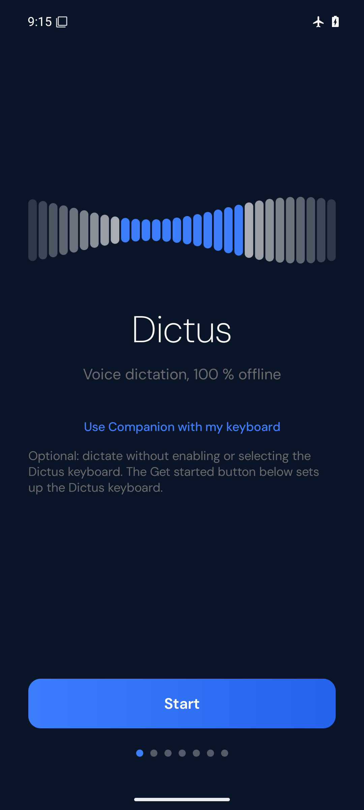
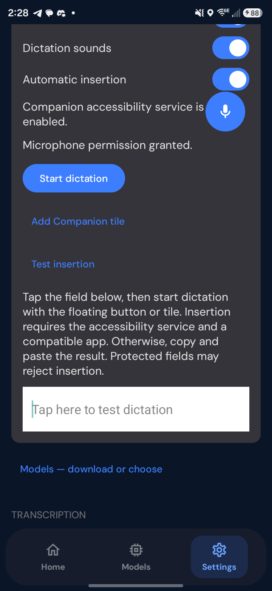

# Companion Mode

## Status and scope

Companion lets users keep their usual keyboard and invoke Dictus dictation through an optional floating control or Quick Settings tile. It is opt-in and does not require enabling or selecting the Dictus IME. Host tests and Android 15/API 35 emulator checks have run; this is a testable implementation, not a physically validated release. Exact evidence is in [TESTING_COMPANION_MODE.md](TESTING_COMPANION_MODE.md).

The primary physical target is Samsung Galaxy S24 Ultra with Samsung Keyboard, as clarified by the device owner; Gboard is secondary. The tested SM-S928U1 runs Android 16/API 36, reports One UI build value 80500 and uses Samsung Keyboard. Native Whisper fixture inference, provider reuse and automatic language detection passed on this phone. Ordinary live dictation preserved Samsung Keyboard and produced a Copy transcript, but the built-in field rejected editing spans before capture. That issue is fixed in code with regression coverage; the owner disconnected the phone before the corrected build could be retested. The physical keyboard/app matrix remains pending.

## Setup and controls

1. Choose Companion during onboarding, or enable it in Settings → Companion. The onboarding path leaves the system keyboard selection unchanged.
2. Open Models, download a model, and select it. Companion reads the shared active-model and transcription-language preferences. Missing models produce a failure rather than an automatic download during dictation.
3. Start with Copy mode. Grant microphone permission when prompted. Copy mode does not require accessibility access or display-over-other-apps permission.
4. Add the Companion Quick Settings tile. On supported versions the settings UI requests tile placement; otherwise add it through the system tile editor.
5. Optionally enable the floating button after the overlay-permission explanation. Drag it vertically and dock it to either side. Position preferences persist; active audio and results do not.
6. Optionally allow notifications. The implemented recording notification has Stop-and-transcribe and Cancel actions. The overlay notification opens controls; a separate result notification opens the in-memory result without displaying transcript text in its notification body. Permission denial and OEM notification behavior need device testing.
7. Optionally enable automatic insertion only after reading the disclosure and manually enabling Companion in Android Accessibility settings. Returning from settings refreshes permission indicators. Declining consent keeps Copy mode available.

Tap the floating button or tile to start. While recording, another tap stops capture and requests transcription. While preparing, transcribing, or inserting, repeated taps must not start another operation. A retained result opens controls instead of starting a new session. Long-pressing the floating button opens controls, including Cancel during work, Hide floating button, Settings, and explicit result dismissal. Companion settings provide haptic and sound toggles that update the same global Dictus preferences.

Notification actions provide the optional software shortcut mechanism. Pinned launcher shortcuts and volume-key, power-key, headset-button, or other hardware hooks are not implemented.

## Visible activation and foreground services

The floating button and tile do not directly start background microphone capture. They open `CompanionActivationActivity`, a visible dialog-style activity. The activation path waits for resume/window focus and microphone permission, binds the existing `DictationService`, and checks activity visibility again before acquiring Companion ownership and starting capture. The activity returns to the user's app after the controller reports recording, rather than after a guessed delay. Recreated activities open controls instead of silently restarting recording.

`DictationService` owns audio capture and promotes itself with the microphone foreground-service type before opening the microphone. Companion shares this existing capture/transcription pipeline with the Dictus IME and recording UI. Session ownership prevents concurrent legacy/IME and Companion recordings, including pending starts and transcription cleanup. The coordinator observes `service.companionFailure` and calls `session.fail()` for reported capture failures, including microphone/permission failures and screen lock; binding loss cancels active work. Verify the final error propagation and cleanup on device.

`CompanionOverlayService` has a separate purpose: maintain the user-enabled, persistent draggable dictation control. Its declared `specialUse` subtype truthfully describes that visible control and explicitly states that microphone capture belongs to a separate service after visible activation. The overlay service never opens the microphone. Its ongoing notification describes the floating control rather than claiming idle recording. This declaration is not evidence of platform acceptance or store approval.

The overlay detaches on screen-off, blocks attachment while locked, and is configured `START_NOT_STICKY`. The microphone service also uses `START_NOT_STICKY`. Screen lock, permission loss, microphone failure, and service teardown must terminate the active session without a later insertion or automatic recording restart. Verify actual state/error propagation and cleanup against the current implementation.

## Shared engine and bounded cache lifetime

Companion uses the same `DictationService` provider slot, downloaded model files, model selection, language setting, and post-processing as existing dictation. It does not create an independent engine cache. `SttProviderSlot` serializes initialization, use, replacement, and release; it reuses only the same ready provider class and exact model key. Changing model/provider releases the old native context before replacement.

The configured idle timeout is **10 minutes after completed provider use**, renewed by subsequent use. This is an upper idle retention window within a live service, not a guarantee that a model stays warm for ten minutes. Activity/overlay clients and other bindings affect service lifetime; when the service is destroyed, its cleanup releases the provider sooner. Process death also removes the cache. Idle expiry must not free a provider during active inference. Downloaded model files remain separate from this native-memory lifetime.

There is **no silence detection or voice activity detection (VAD)** in the Companion recording path. The user explicitly stops recording. The existing minimum-duration check rejects clips below 500 ms; waveform energy updates and the transcription timeout are not VAD or automatic end-of-speech detection.

## Conservative optional insertion

Accessibility enablement alone does not capture editor text or insert anything. The explicit launch path attempts to capture the focused target before opening activation controls. The manager retains an immutable text/selection snapshot and identity metadata in memory, using an opaque single-use target; it does not retain accessibility nodes. Focus/window event handling tracks identity changes and does not consume event text for dictation.

Current support requires an enabled, visible, focused, editable native plain `android.widget.EditText` exposing both set-text and set-selection actions. All numeric input fields (`TYPE_CLASS_NUMBER`) are rejected for OTP safety, including ordinary numeric fields without password metadata. Password input variations, password metadata, accessibility-sensitive fields, System UI, document-formatting spans, unsupported classes, invalid selections, and malformed UTF-16 are also rejected. Ancestor checks reject WebView-backed fields even when the focused node reports the native `EditText` class, and reject password/sensitive ancestors. WebViews, Compose/custom/virtual editors, and rich editors are outside supported automatic insertion. A supported-looking editor still needs device verification.

Immediately before insertion, the manager reacquires the editor and verifies the original identity, text, and selection. It replaces the selected range or inserts at the cursor while preserving prefix/suffix, then reacquires the editor to verify the text and final cursor. Any action failure or uncertainty after attempting a write is a partial/unverified result; the target is consumed and must not be automatically retried.

Opening the activation activity temporarily changes focus. `ActivationTransition` provides a narrowly bracketed exception for the exactly identified activation window and return to the original editor. After that activity explicitly finishes, the original window may briefly lack editor focus; insertion stays disabled until the exact original editor returns. A window-list event for the known activation/original window may also briefly expose no active root during the confirmed bracket; this keeps insertion disabled while waiting. Unknown windows, input-focus events without a target, and other apps cannot use that exception. Window and editor metadata are resolved from the same root, and non-editable dialog buttons are not treated as editor targets. Unrelated focus/window transitions must invalidate the capture, even if the user returns to that field later. The actual enabled service has passed this round trip, including real microphone startup with notifications enabled, in an API 35 native-field fixture. Arbitrary focus changes, notification-shade transitions, and Samsung One UI event ordering are not established by that test. Failure to complete the handshake must leave a Copy result.

## Results, cancellation, and privacy

The ordinary success sequence is IDLE → PREPARING → RECORDING → TRANSCRIBING → INSERTING → COMPLETED. Cancellation invalidates the operation generation, aborts capture, and releases its ownership. Obsolete completions must not insert, mutate a replacement session, or release the replacement session's ownership. `fail()` cancels busy work, aborts and releases ownership, and sets ERROR with the `capture` reason. Repeated failure reports leave idle/completed sessions and retained results unchanged.

When automatic insertion is off, unavailable, rejected, throws, or cannot be verified, the transcript remains in the session's process memory for manual recovery. Controls show the result and a warning to inspect the destination before pasting, because an unverified write may already have changed it. **Copy writes the clipboard only after the user taps Copy.** There is no automatic clipboard write or paste. Copying does not itself dismiss the result. A retained transcript blocks another session until explicit dismissal; dismissal clears the retained result.

Controller retry tests exercise single successful consumption, but the insertion manager's target is single-use and partial writes must never trigger an automatic retry. Do not promise a retry button or guaranteed replay into an old external field.

Companion requests `EPHEMERAL` retention from the shared pipeline: it does not save the result to transcription history or persist captured editor contents. Preferences and downloaded model files may persist independently. External editor contents can be read in memory only for optional insertion checks; Android accessibility access is broader than that implementation purpose, as disclosed before opt-in.

Process death loses an uncopied, undismissed ephemeral result. A notification is not durable transcript storage. Returning to the app or recreating controls must not silently restart capture. The user must explicitly start a new recording. Device validation must also check that logs and notifications do not expose dictated or captured field text.

## Source map

| Responsibility | Source |
| --- | --- |
| Setup, consent, permission indicators, native test editor | `app/src/main/java/dev/pivisolutions/dictus/companion/settings/` |
| Visible activation and shared coordination | `CompanionActivationActivity.kt`, `CompanionCoordinator.kt`, `CompanionLauncher.kt` in the Companion package |
| Session state and stale-operation protection | `app/src/main/java/dev/pivisolutions/dictus/companion/CompanionSession.kt` |
| Floating control, tile, notification actions | `CompanionOverlayService.kt`, `CompanionTileService.kt`, `CompanionActionReceiver.kt` in the Companion package |
| Optional editor access and focus handshake | `app/src/main/java/dev/pivisolutions/dictus/companion/insertion/` |
| Audio ownership, capture, recognition, native cache | `app/src/main/java/dev/pivisolutions/dictus/service/` |
| Permissions, service types, accessibility declaration | `app/src/main/AndroidManifest.xml`, `app/src/main/res/xml/companion_accessibility_service.xml` |

## Validation build variants

Normal Gradle builds retain the repository's ARM native ABIs. The upstream `-Pdictus.emulatorAbi=true` property adds x86_64 to debug builds of the same Whisper source for an x86 emulator; it creates no second speech pipeline or model manager. Use the normal ARM APK on a physical ARM phone. The emulator test ABI is not a physical-device compatibility claim.

For a phone that already has a release installation, `-PdictusSideBySide=true` creates **Dictus Companion Test** with a separate application ID and data. It leaves the installed release untouched. Both the tile and Accessibility components use their actual class names, independently of the application ID.

ARM translation on the API 35 x86 emulator aborted inside libomp during inference; a test-only affinity override also failed. Native x86 inference passed with networking disabled. Do not use ARM translation as recognition or performance evidence. Physical ARM Tiny recognition, provider reuse and automatic language detection subsequently passed on the S24 Ultra; live microphone quality and Parakeet remain separate checks.

The S24 Ultra exposed an Android 16 debug compatibility warning in the original build. Project-built Whisper/ggml/trie libraries now link with 16 KB load alignment. The APK passes `scripts/check_android_page_alignment.py` for all packaged 64-bit ELF load segments and uncompressed ZIP entries. Bundled prebuilt libraries already pass. The physical phone uses 4 KB pages, so this is alignment evidence rather than a claim of runtime testing on 16 KB-page hardware.

The shared model cache also releases idle native allocations under memory pressure. The service now passes the actual `auto` language setting to whisper.cpp instead of replacing it with French. Accessibility insertion rejects fields/results beyond 16,384 UTF-16 units and rejects an insertion that would exceed a field's exposed maximum length, before attempting any text action. Native non-copying cursor/change-listener spans, Android's internal DynamicLayout observer and spell-check metadata are accepted. An underline is accepted only while marked `SPAN_COMPOSING`, as used by Samsung's IME for transient composition. Committed underlines, other document formatting and links remain unsupported. Hidden platform metadata is recognized by type name without invoking hidden APIs.

Debug builds report generic capture/insertion failure enum codes under the `DictusCompanion` log tag. These diagnostics contain no field content, dictated text, editor identity, app name or window history. Release builds do not emit them. This permits ordinary physical-device testing without a method-level debugger or instrumentation runner that interferes with accessibility service lifecycle.

## Setup screenshot

Actual Android 15/API 35 emulator capture of the Companion entry point. This is not a Samsung or external-app screenshot.

Actual S24 Ultra/API 36 setup during physical validation, showing the floating control and native test area. This records setup, not successful insertion.

## Permissions

| Permission or system access | Purpose | Without it |
| --- | --- | --- |
| `RECORD_AUDIO` | Explicitly started microphone capture. Requested at dictation start. | Recording cannot start; settings explain recovery. |
| `FOREGROUND_SERVICE`, `FOREGROUND_SERVICE_MICROPHONE` | The existing recording service and its visible microphone notification. Normal manifest permissions, not additional user prompts. | Recording service cannot run on versions requiring them. |
| `SYSTEM_ALERT_WINDOW` | Optional floating control, after the in-app explanation and Android overlay settings. | Use the tile or in-app activation. |
| `FOREGROUND_SERVICE_SPECIAL_USE` | API 34+ persistent user-enabled floating control, with a declared subtype. It does not authorize microphone capture. | Floating service cannot run where this permission is required. |
| `POST_NOTIFICATIONS` | Optional API 33+ recording actions and retained-result notification. | Use the floating control or tile; foreground-service operation still follows Android's platform rules. |
| Accessibility service enablement | Optional selected-field capture and insertion, after explicit disclosure. `BIND_ACCESSIBILITY_SERVICE` restricts the service binder to Android; it is not a normal permission the app grants itself. | Manual Copy mode works. |
| `BIND_QUICK_SETTINGS_TILE` | Restricts the tile-service binder to Android. Users add the tile themselves. | No application-controlled grant is requested. |
| `INTERNET` | Existing model downloads only; not added for Companion. | Already downloaded models remain local. |

The accessibility disclosure describes in-memory selected-field access, no unrelated text inspection, no logging or network transmission, and optional Copy mode. Enabling the Android service does not capture any editor text by itself. No root, ADB permission grant, default-keyboard change, or clipboard read is part of normal use. ADB/shell operations in the test instructions are test setup only.

## Floating window implementation

`WindowManager` hosts a 56 dp circular `ImageButton` in `TYPE_APPLICATION_OVERLAY`, with `FLAG_NOT_FOCUSABLE` and `FLAG_NOT_TOUCH_MODAL`. Its window covers only the button's bounds. It does not acquire the text field's input focus or consume touches elsewhere. Dragging saves a dock side and normalized vertical position in the existing DataStore. Repositioning clamps to display/system gesture/cutout insets; configuration changes recompute the bounds. Unchanged inset callbacks do not reset dragging.

Recording uses the Dictus recording color; preparation/transcription uses a processing icon with rotation only when Android animations are enabled. Success is briefly confirmed; errors are distinct. TalkBack descriptions follow the state. Long press opens explicit Cancel/Hide/Settings/result controls. The window is detached while locked and remains subject to Android's suppression of untrusted overlays on protected system surfaces. The default height leaves room for the keyboard; users can reposition it.

## Android compatibility evidence

| Android/API | Status |
| --- | --- |
| Android 10–12 / API 29–32 | Existing minimum SDK retained. API guards/code reviewed; runtime not tested in this environment. |
| Android 13 / API 33 | Optional notifications and tile-add request guarded appropriately; separate runtime validation not performed. |
| Android 14 / API 34 | Visible-activity microphone admission, microphone/special-use declarations, and PendingIntent tile path implemented; separate runtime validation not performed. |
| Android 15 / API 35 | Compile/target SDK retained. Twenty-two native x86_64 emulator instrumentation tests passed, including composing-span insertion, actual microphone, SystemUI tile admission and cross-application native insertion. |
| Android 16 / API 36 | Physical ARM Tiny fixture recognition and ordinary live transcription passed on S24 Ultra. Initial insertion failed; the editing-span correction awaits device retest. Build toolchain remains SDK 35. Later OS versions are untested. |
| Samsung One UI / Galaxy S24 Ultra | Samsung Keyboard selection preserved. Initial native-field insertion failed; corrected build and external-app matrix remain unverified. |
| Gboard | Default selection preserved in the API 35 native fixture. External-app behavior and physical Gboard are not certified. |
| SwiftKey | Not tested. |

## Known limitations and recovery

- Automatic insertion supports verified plain native `EditText` fields, not arbitrary rich, WebView, Compose or virtual document controls. Numeric/PIN/OTP/password/sensitive fields are rejected. Native non-copying editing markers are accepted; document styles and links are rejected.
- Text and results are limited to 16,384 UTF-16 units for this insertion route. The manager also checks exposed maximum length before any text action so an insertion cannot knowingly truncate an existing suffix.
- `ACTION_SET_TEXT` is a whole-value action with no compare-and-set contract. Applications that transform or concurrently rewrite their own document state require Copy recovery; validation cannot make a third-party editor atomic. The manager rejects detected content/selection/identity changes and does not retry an uncertain write.
- Opening activation can temporarily hide the keyboard. Returning focus depends on Android/the target app; Dictus never forces focus to an unrelated editor or simulates coordinate-based text insertion. Shade, dialogs or other app switches can invalidate automatic insertion.
- A failed recognition consumes the captured clip; retry means explicitly recording again. Cancelling native inference may wait for an uninterruptible native call to return before its ownership is reusable. Microphone capture ends independently.
- Uncopied results are in process memory only. Process death loses them; no automatic recording restart or transcription-history persistence is promised. Copy is explicit, and an uncertain write requires checking the destination before pasting to avoid duplicates.
- There is no continuous idle recording, silence/VAD auto-stop, hardware-key hook, or pinned-home shortcut. Notification actions and the tile provide additional controls.

## Troubleshooting

| Symptom | Check/recovery |
| --- | --- |
| Floating control absent | Enable Companion and its floating option; verify Android Display over other apps permission. Return to Companion settings to show it after a service/process interruption. Unlock the device. |
| Recording will not start | Grant microphone permission at explicit launch, select a downloaded model in Models, and start from the visible activation flow. Check Android microphone privacy controls or another app's capture conflict. |
| Model missing | Open the existing Models screen, download/select one there, then explicitly retry. Companion never downloads a model during capture. |
| Recording stopped unexpectedly | Screen lock, microphone silencing/revocation, or service termination ends the session. Reopen controls and start a new recording only after resolving the cause. |
| Text did not appear | Check accessibility status and the automatic-insertion toggle. Keep the original native field focused and unchanged; otherwise open the retained result and tap Copy. |
| Verification failed after insertion | Inspect the destination before manual paste: some text may already have been written. Automatic replay is deliberately unavailable. |
| Notifications declined | Stop with the floating button or tile. Tap the tile again after processing to reopen a retained result. |
| Tile not visible | Add Dictus Dictation from the system tile editor and check later Quick Settings pages; optionally move it to a convenient position. |
| Emulator inference aborts | Use the explicit native x86_64 test build on an x86 emulator. ARM translation/libomp is not a supported inference validation route. Use the normal ARM build on the physical phone. |

The device/app procedures in [TESTING_COMPANION_MODE.md](TESTING_COMPANION_MODE.md) distinguish verified emulator behavior from remaining physical/OEM checks.
