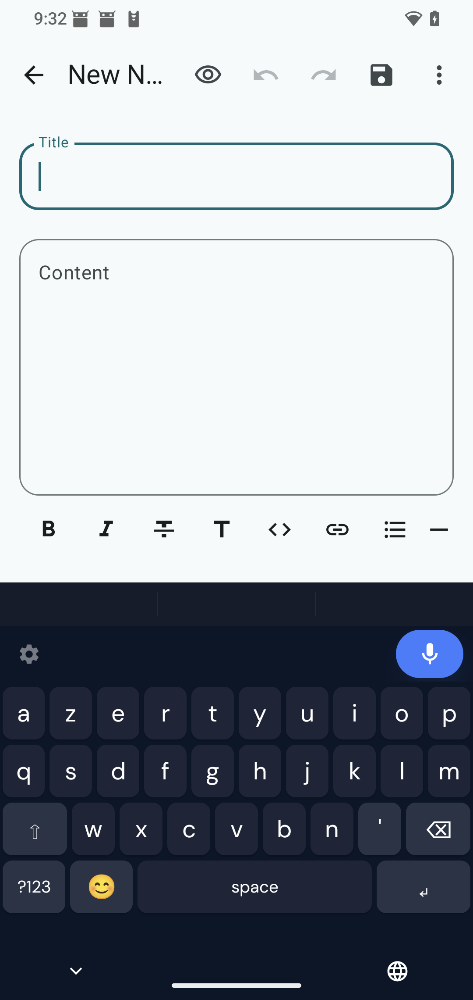
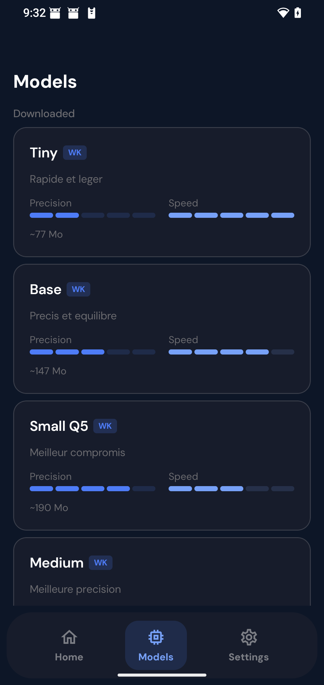
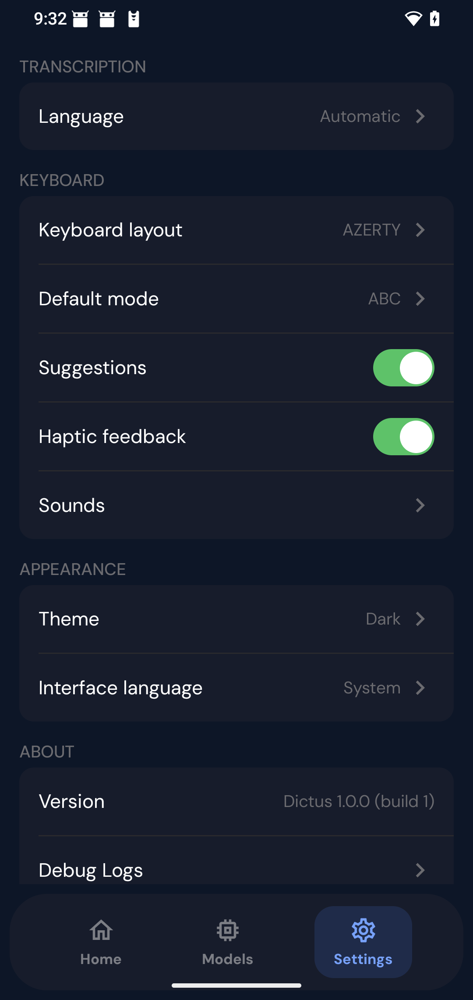

  

<h1 align="center">Dictus for Android</h1>

  <strong>Free, open-source Android keyboard for voice dictation — 100% on-device.</strong> 
  Speak in any app. No cloud, no account. Dictation is free.

  
  
  
  
  

  <a href="https://getdictus.com">Website</a> ·
  <a href="https://github.com/getdictus/dictus-android/releases/latest">Download APK</a> ·
  <a href="https://github.com/getdictus/dictus-ios">iOS</a> ·
  <a href="https://github.com/getdictus/dictus-desktop">Desktop</a> ·
  <a href="https://t.me/getdictus">Community</a>

  

---

Dictus is a free, open-source Android keyboard that adds voice dictation to any app. All speech recognition runs **on-device** via Whisper (whisper.cpp) and NVIDIA Parakeet (sherpa-onnx), with no server and no account. Dictation is free; Dictus Pro, with optional paid features, is in development.

## Why Dictus?

- 🔒 **100% on-device** — your voice never leaves your phone. No cloud, no telemetry, no account.
- 🆓 **Free dictation, open source**: MIT licensed, fully auditable code.
- ⌨️ **System-wide IME** — works in every app as your default keyboard.
- ⚡ **Multi-engine** — Whisper (multilingual) or Parakeet (English, fast).
- 🌐 **FR + EN dictionaries** — smart word predictions while typing.

## How Dictus compares

| Feature | **Dictus** | Wispr Flow | Gboard Voice | SuperWhisper |
| --- | :---: | :---: | :---: | :---: |
| Price | **Free** dictation (Pro in development) | Free / $15/mo | Free | Free / $8.49/mo |
| 100% offline | ✅ | ❌ | ⚠️ | ⚠️ |
| Privacy-first | ✅ | ❌ | ⚠️ | ⚠️ |
| Open source | ✅ | ❌ | ❌ | ❌ |
| System keyboard | ✅ | ❌ | ✅ | ❌ |
| Cross-platform | ✅ ([iOS](https://github.com/getdictus/dictus-ios) · [Android](https://github.com/getdictus/dictus-android) · [Desktop](https://github.com/getdictus/dictus-desktop)) | iOS · macOS · Win · Android | Android · Wear OS | iOS · macOS · Win |

See the full comparison on [getdictus.com](https://getdictus.com).

## Install the beta

Dictus is currently in public beta — install by sideloading the APK from [GitHub Releases](https://github.com/getdictus/dictus-android/releases/latest).

1. On your Android device, go to **Settings → Apps → Special app access → Install unknown apps** and allow your browser.
2. Download the latest APK from [Releases](https://github.com/getdictus/dictus-android/releases/latest).
3. Open the `.apk` and tap **Install**.
4. Go to **Settings → System → Languages & input → On-screen keyboard → Manage on-screen keyboards**.
5. Enable **Dictus**.
6. Open any text field, tap the keyboard icon in the navigation bar, and select **Dictus**.

**Requirements:** Android 10 (API 29) or higher · ~150 MB for the smallest Whisper model.

## Companion setup (keep your usual keyboard)

Companion is an opt-in way to dictate while keeping Samsung Keyboard, Gboard, or another keyboard selected. Choose **Use Companion with my keyboard** during onboarding, or open **Settings → Companion Dictation**. Host tests and Android 15 emulator checks have run. On the Galaxy S24 Ultra, offline recognition and Samsung Keyboard preservation passed; the initial native-field insertion failed. Its editing-span correction is implemented and awaits physical retesting because the phone is no longer connected. The external-app matrix remains pending.

1. Download and select a speech model in **Models** before dictating. Companion uses the same on-device engine and model settings as Dictus; it does not download a missing model during a session.
2. Enable **Companion**. Start with **Copy mode**, which needs neither accessibility nor overlay permission. Allow microphone access when starting dictation.
3. Add the **Dictus Dictation** Quick Settings tile, or optionally enable the **floating button** and grant **Display over other apps**. Allow notifications to make recording controls and result reminders visible. Notification actions provide the optional software shortcut mechanism.
4. Tap the floating button or tile to start. A visible activation window opens while the microphone service starts, then returns you to your app. Tap again while recording to stop and transcribe; notification controls also provide **Stop** and **Cancel**. There is no silence detection or VAD auto-stop.
5. If using Copy mode, or if insertion is unsafe or cannot be verified, open the result controls and tap **Copy**, then paste yourself. Check the destination first: a failed verification can mean some text was already written. The result remains only in process memory until dismissed; process death loses it. Recording never silently restarts after process death.

**Automatic insertion is optional.** Review the in-app disclosure and explicitly enable the Companion accessibility service in Android settings. Current insertion support is deliberately limited to native plain `android.widget.EditText` fields. All numeric fields are rejected for OTP safety; password/sensitive fields, rich editors, fields with a WebView ancestor (even if exposed as `EditText`), and unknown editors fall back to Copy. Companion settings include haptic and sound toggles shared with Dictus. The primary validation target is Samsung Galaxy S24 Ultra with Samsung Keyboard, as clarified by the device owner; Gboard is secondary. Companion does not install hardware-button hooks.

See [Companion behavior and architecture](COMPANION_MODE.md) and the [test results and device validation matrix](TESTING_COMPANION_MODE.md).

## Screenshots

| Keyboard | Model Manager | Settings |
|----------|---------------|----------|
|  |  |  |

## Features

- **Offline voice dictation** — Whisper + NVIDIA Parakeet, entirely on-device
- **Multi-engine STT** — Whisper (multilingual) or Parakeet (English, fast)
- **Smart suggestions** — word predictions from FR+EN dictionaries while typing
- **Personal dictionary** — learns your frequently typed words
- **System keyboard** — works in any app as your default IME
- **AZERTY & QWERTY** — switchable keyboard layouts

## Roadmap

- [x] On-device Whisper + Parakeet engines
- [x] System IME with AZERTY / QWERTY layouts
- [x] FR + EN word predictions and personal dictionary
- [ ] Smart Modes (Dictus Pro) — on-device LLM reformulation
- [ ] Custom vocabulary (technical terms, names)
- [ ] Searchable local transcription history
- [ ] Audio-file transcription
- [ ] Sync settings across Dictus iOS / Android / Desktop (offline-first)

Have an idea? Open a [feature request](https://github.com/getdictus/dictus-android/issues/new) — we prioritize the most-upvoted ones.

## Tech stack

- Kotlin + Jetpack Compose
- [whisper.cpp](https://github.com/ggerganov/whisper.cpp) (MIT) — Whisper STT
- [sherpa-onnx](https://github.com/k2-fsa/sherpa-onnx) (Apache 2.0) — Parakeet STT
- Material Design 3

## Contributing

Contributions are welcome — see [CONTRIBUTING.md](CONTRIBUTING.md) for build setup, module overview, and PR guidelines. Good entry points:

- `good first issue` and `help wanted` in [Issues](https://github.com/getdictus/dictus-android/issues)
- Bug reports with logs from a recent build
- Translations & locale tuning

## Privacy

Dictus collects no user data. All speech processing happens on your device. See our [Privacy Policy](https://www.getdictus.com/en/privacy).

## Support the project

Dictation in Dictus is free and the code is open source. If it helps you every day, you can [donate](https://getdictus.com/donate): donations fund the free version of Dictus, including Dictus Desktop. They do not unlock Dictus Pro.

## Community

- 🌐 [getdictus.com](https://getdictus.com)
- 💬 [Telegram](https://t.me/getdictus)
- 🐛 [Issues](https://github.com/getdictus/dictus-android/issues)
- 📧 [hello@getdictus.com](mailto:hello@getdictus.com)

## License

MIT — see [LICENSE](LICENSE).

---

  Made with ❤️ by <a href="https://pivi.solutions">PIVI Solutions</a> · <a href="https://github.com/getdictus">@getdictus</a>

