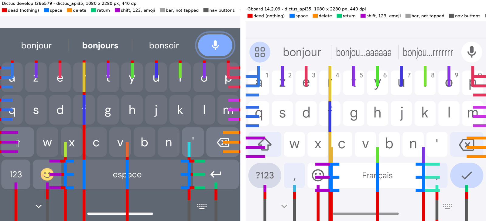
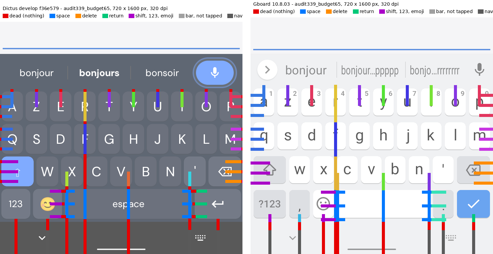
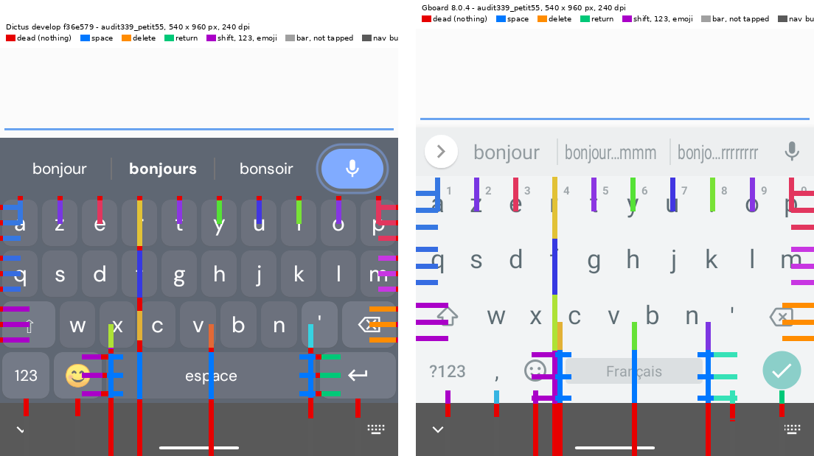

# Keyboard ergonomics against Gboard (#370)

Measurement only: nothing in `app/`, `ime/`, `core/` or `trie/` changes. Taken 2026-11-21 on
three emulator profiles, portrait, French AZERTY, for the Dictus keyboard and for Gboard on the
same screen.

Pierre's report (#370): next to Gboard, the Dictus keyboard does not feel at Gboard's level, and
on Gboard a tap slightly below the space key still types a space, on Dictus it does not. What the
numbers say:

- **Dictus's keys are not smaller than Gboard's** on the Pixel 4 screen: they are taller (48.7 dp
  against 40.4 dp) and as wide (35.3 dp against 34.2 dp), and the same holds on the 360 x 800 dp
  phone. Only on the 360 x 640 dp phone are its rows shorter (46 dp against 50 dp), because the
  40 % height cap of `KeyboardSizing.kt` binds there.
- **What Gboard has and Dictus lacks is touch area.** Every point of Gboard's keyboard, from the
  suggestion strip down to the navigation bar and from one screen edge to the other, types a key.
  Dictus types only on its drawn keys: the 4 dp between two keys, the 4 dp between two rows, the
  2 dp at each screen edge, the rounded corners of each key, the strip between the toolbar and the
  top row and the strip under the bottom row all type nothing.
- **The space bar:** Gboard's touch area runs 6 to 17 dp below its drawn key, down to the
  navigation bar. Dictus's stops at the drawn key's edge, then 4 dp of nothing before the
  navigation bar.
- Closing the dead bands, simulated on the #382 replay without touching the app, takes Dictus from
  21 to 12 wrong words of 152 in French and from 25 to 17 of 157 in English; letting the bottom
  row reach the navigation bar takes English to 13. Gboard left 1 and 5 on the same taps (#382).

## Ranked fixes

Ranked by measured effect on the #382 replay (`dictus_api35`, the 1607 taps of
`tools/keyboard-bench/runs/`, develop `f36e579`). A fix is "simulated" when `run.sh --snap` moves
each tap where the fixed keyboard would have taken it, on the real keyboard with its own
autocorrect; the app is not changed (see Method).

| # | Fix | What iOS does | Measured or estimated effect | Risk |
|---|---|---|---|---|
| 1 | **Close the dead bands.** Each key's touch area becomes its whole cell: the gap between two keys and between two rows is split at its middle, the 2 dp row padding goes to the edge keys, and the rounded corners count. The drawn keys do not move. | The grid is cells with no spacing (`KeyboardView.swift:1170`, `:1174` return 0); each cell is `(width - 1) / units` wide (`:1164`), so 1/9 pt is left between cells; the drawn key is inset 3 pt across and 5.5 pt down inside its cell (`Theme.swift:213`, `:200`), so the boundary is the middle of the visible gap. | Simulated (`--snap gaps`): wrong words fr **21 → 12**, en **25 → 17**; wrong letters fr 26 → 16 (3.9 % → 2.4 %), en 36 → 24 (5.7 % → 3.8 %); miscorrections fr 11 → 8, en 7 → 6. Of the 47 taps that typed nothing, 33 landed between two keys of a row, 8 between two rows, 1 at a screen edge. Example (fr): the replay typed « une » as `ne` (kept wrong) and `ue` (put back to `une` by the trie); with the bands closed it types `une` both times. #386 measured the same word on the #384 bench with its spatial decoder (off by default): `ue`, the n in a dead band, comes out as « je » from the decoder where the trie had found « une ». A dead band does not only lose a letter, it can make a correction layer worse. | Low. Only points that typed nothing change; every tap on a drawn key types what it typed before. To check on the device: the space bar's trackpad (a drag that leaves the drawn key), the accent popup, delete's repeat. |
| 2 | **Bottom row down to the navigation bar.** The space bar (and 123, emoji, return) takes the 4 dp under it (the key's own 2 dp padding and the grid's 2 dp), as Gboard and iOS do. | The grid is pinned to the input view's bottom (`KeyboardViewController.swift:305`); the space cell runs 5.5 pt under the drawn key to the grid's edge. Below the extension's view nothing types (the iOS baseline lost one space there, `954-keyboard-baseline/README.md:46`). | Simulated on top of fix 1 (`--snap gaps,below`): en wrong words **17 → 13**, missed space taps en 3 → 1; fr unchanged (no French space tap landed there). | Low, if it stops at the navigation bar: the bar's own buttons (hide keyboard, switch keyboard) stay the system's. |
| 3 | **Top row up to the toolbar.** The strip between the toolbar and row 1 (3.6 to 4 dp) types the top-row key under it. | Same as fix 1: the top-row cell starts 5.5 pt above the drawn key, at the grid's top; the toolbar is a separate view above it (`KeyboardViewController.swift:72`) and keeps its own touches. | Not simulated (`--snap` has no mode for it). In the replay, 1 French and 2 English letter taps landed above row 1: at most 3 letters. | Low; the toolbar must keep its height and touches. |
| 4 | **Edge keys to the screen edge.** a, q, p, m, shift and delete take the 2 dp row padding. Part of fix 1. | `clampedPoint` pulls every touch 4 pt inside the grid (`KeyboardView.swift:830`) so the edge cells catch it. | Included in fix 1's simulation: 1 English tap. | Low. |

Not proposed:

- **Bigger keys.** On the Pixel 4 screen Dictus's keys are already larger than Gboard's. On the
  small 360 x 640 dp phone they are 4 dp shorter than Gboard's rows (the 40 % portrait cap of
  `KeyboardSizing.kt` binds there); raising that cap is a separate choice with its own cost (less
  of the app visible) and nothing in this replay measures it.
- **Touch areas that follow the language model** (Gboard does it; iOS has it as a bench spike,
  dictus-ios #949 and PR #973, not in the keyboard): that is #386's spatial decoder, measured
  there. Fix 1 is a precondition: a decoder can only move a boundary that exists.

With fixes 1 and 2, Dictus is left with 12 and 13 wrong words where Gboard had 1 and 5. The
rest is mostly autocorrect (8 and 6 miscorrections), not geometry: see #382.

## Geometry

Drawn keys, read on a capture of each keyboard (`geometry.py`), and touch areas, read by tapping
(`zones.txt`). px on the profile's screen, dp in brackets.

### `dictus_api35`, 1080 x 2280 px, 440 dpi (393 x 829 dp), the Pixel 4 screen

| | Dictus (drawn) | Gboard (drawn) |
|---|---:|---:|
| Letter key, width | 97 (35.3) | 94 (34.2) |
| Letter key, height | 134 (48.7) | 111 (40.4) |
| Gap between two keys | 11 (4.0) | 12 (4.4) |
| Gap between two rows | 12 (4.4) | 27 (9.8) |
| Screen edge to the first key | 6 (2.2) | 12 (4.4) |
| Row pitch (centre to centre) | 146 (53.1) | 138 (50.2) |
| Space bar, width | 569 (206.9) | 416 (151.3) |
| Bar above the keys (toolbar, strip) | 144 (52.4) | 121 (44.0) |
| Keys, top of row 1 to bottom of row 4 | 571 (207.6) | 531 (193.1) |
| Keyboard, top of the bar to the screen bottom | 870 (316.4) | 822 (298.9) |
| Below row 4 to the screen bottom (navigation bar included) | 144 (52.4) | 148 (53.8) |

### `audit339_budget65`, 720 x 1600 px, 320 dpi (360 x 800 dp)

| | Dictus (drawn) | Gboard (drawn) |
|---|---:|---:|
| Letter key, width | 64 (32.0) | 61 (30.5) |
| Letter key, height | 89 (44.5) | 83 (41.5) |
| Gap between two keys | 8 (4.0) | 10 (5.0) |
| Gap between two rows | 8 (4.0) | 18 (9.0) |
| Screen edge to the first key | 4 (2.0) | 9 (4.5) |
| Row pitch (centre to centre) | 97 (48.5) | 101 (50.5) |
| Space bar, width | 378 (189.0) | 275 (137.5) |
| Bar above the keys (toolbar, strip) | 104 (52.0) | 88 (44.0) |
| Keys, top of row 1 to bottom of row 4 | 380 (190.0) | 388 (194.0) |
| Keyboard, top of the bar to the screen bottom | 597 (298.5) | 594 (297.0) |
| Below row 4 to the screen bottom (navigation bar included) | 105 (52.5) | 106 (53.0) |

### `audit339_petit55`, 540 x 960 px, 240 dpi (360 x 640 dp)

| | Dictus (drawn) | Gboard (touch areas) |
|---|---:|---:|
| Letter key, width | 48 (32.0) | 53 (35.3) |
| Letter key, height | 63 (42.0) | 75 (50.0) |
| Gap between two keys | 6 (4.0) | 0 (0.0) |
| Gap between two rows | 6 (4.0) | 0 (0.0) |
| Screen edge to the first key | 3 (2.0) | 0 (0.0) |
| Row pitch (centre to centre) | 69 (46.0) | 75 (50.0) |
| Space bar, width | 284 (189.3) | 214 (142.7) |
| Bar above the keys (toolbar, strip) | 78 (52.0) | 66 (44.0) |
| Keys, top of row 1 to bottom of row 4 | 270 (180.0) | 299 (199.3) |
| Keyboard, top of the bar to the screen bottom | 432 (288.0) | 446 (297.3) |
| Below row 4 to the screen bottom (navigation bar included) | 78 (52.0) | 72 (48.0) |

## Touch maps

Taps 2 px apart along lines around the zones of #370, and what each one typed. Red typed nothing;
blue is the space bar; each letter has its own colour; grey under the keys is the navigation
bar's own buttons (hide keyboard, switch keyboard); the bar above the keys is not tapped (the
microphone is there). Dictus on the left, Gboard on the right.

### `dictus_api35`, 1080 x 2280 px, 440 dpi (393 x 829 dp), the Pixel 4 screen

### `audit339_budget65`, 720 x 1600 px, 320 dpi (360 x 800 dp)

### `audit339_petit55`, 540 x 960 px, 240 dpi (360 x 640 dp)

## Dictus against Gboard, zone by zone

Dead means a tap there types nothing. To the 2 px step of the map.

### `dictus_api35`, 1080 x 2280 px, 440 dpi (393 x 829 dp), the Pixel 4 screen

| Zone | Dictus px (dp) | Gboard px (dp) |
|---|---:|---:|
| Row 1 to the bar above it: dead | 10 (3.6) | 0 (0.0) |
| Row 1 to row 2 (column r): dead | 12 (4.4) | 0 (0.0) |
| Row 3 to the space bar: dead | 12 (4.4) | 0 (0.0) |
| Space bar: touch area below the drawn key (Gboard 8: its pill) | 0 (0.0) | 17 (6.2) |
| Below the space bar to the screen bottom: types nothing | 144 (52.4) | 132 (48.0) |
| Space bar, left side (mid height): dead | 12 (4.4) | 0 (0.0) |
| Space bar, left side (top corner): dead | 24 (8.7) | 0 (0.0) |
| Space bar, right side (mid height): dead | 12 (4.4) | 0 (0.0) |
| Space bar, right side (top corner): dead | 24 (8.7) | 0 (0.0) |
| Screen edge beside a: dead | 6 (2.2) | 0 (0.0) |
| Screen edge beside q: dead | 6 (2.2) | 0 (0.0) |
| Screen edge beside p: dead | 6 (2.2) | 0 (0.0) |
| Screen edge beside m: dead | 6 (2.2) | 0 (0.0) |
| Screen edge beside shift: dead | 6 (2.2) | 0 (0.0) |
| Screen edge beside delete: dead | 6 (2.2) | 0 (0.0) |

### `audit339_budget65`, 720 x 1600 px, 320 dpi (360 x 800 dp)

| Zone | Dictus px (dp) | Gboard px (dp) |
|---|---:|---:|
| Row 1 to the bar above it: dead | 8 (4.0) | 0 (0.0) |
| Row 1 to row 2 (column r): dead | 8 (4.0) | 0 (0.0) |
| Row 3 to the space bar: dead | 8 (4.0) | 0 (0.0) |
| Space bar: touch area below the drawn key (Gboard 8: its pill) | 1 (0.5) | 12 (6.0) |
| Below the space bar to the screen bottom: types nothing | 104 (52.0) | 96 (48.0) |
| Space bar, left side (mid height): dead | 8 (4.0) | 0 (0.0) |
| Space bar, left side (top corner): dead | 14 (7.0) | 0 (0.0) |
| Space bar, right side (mid height): dead | 8 (4.0) | 0 (0.0) |
| Space bar, right side (top corner): dead | 16 (8.0) | 0 (0.0) |
| Screen edge beside a: dead | 4 (2.0) | 0 (0.0) |
| Screen edge beside q: dead | 4 (2.0) | 0 (0.0) |
| Screen edge beside p: dead | 4 (2.0) | 0 (0.0) |
| Screen edge beside m: dead | 4 (2.0) | 0 (0.0) |
| Screen edge beside shift: dead | 4 (2.0) | 0 (0.0) |
| Screen edge beside delete: dead | 4 (2.0) | 0 (0.0) |

### `audit339_petit55`, 540 x 960 px, 240 dpi (360 x 640 dp)

| Zone | Dictus px (dp) | Gboard px (dp) |
|---|---:|---:|
| Row 1 to the bar above it: dead | 6 (4.0) | 0 (0.0) |
| Row 1 to row 2 (column r): dead | 6 (4.0) | 0 (0.0) |
| Row 3 to the space bar: dead | 6 (4.0) | 0 (0.0) |
| Space bar: touch area below the drawn key (Gboard 8: its pill) | 1 (0.7) | 26 (17.3) |
| Below the space bar to the screen bottom: types nothing | 78 (52.0) | 72 (48.0) |
| Space bar, left side (mid height): dead | 6 (4.0) | 0 (0.0) |
| Space bar, left side (top corner): dead | 10 (6.7) | 0 (0.0) |
| Space bar, right side (mid height): dead | 6 (4.0) | 0 (0.0) |
| Space bar, right side (top corner): dead | 8 (5.3) | 0 (0.0) |
| Screen edge beside a: dead | 4 (2.7) | 0 (0.0) |
| Screen edge beside q: dead | 4 (2.7) | 0 (0.0) |
| Screen edge beside p: dead | 4 (2.7) | 0 (0.0) |
| Screen edge beside m: dead | 4 (2.7) | 0 (0.0) |
| Screen edge beside shift: dead | 4 (2.7) | 0 (0.0) |
| Screen edge beside delete: dead | 4 (2.7) | 0 (0.0) |

Where Gboard types and Dictus does not, on every profile: the bands between keys and rows, the
screen edges, the strip above row 1, the corners of every key, and the strip between the bottom
row and the navigation bar. Below that, on the navigation bar, neither types anything.

## iOS (develop `a06e3e1`)

Read with `gh api`, nothing changed. Paths in `getdictus/dictus-ios`.

- **Hit test.** `handleTouches` maps a touch to `collectionView.indexPathForItem(at:
  clampedPoint(...))` (`DictusKeyboard/Vendored/Views/KeyboardView.swift:729`): the key is the
  collection view cell under the finger.
- **Cells tile the row.** Item and line spacing are 0 (`KeyboardView.swift:1170`, `:1174`); a
  cell is `key.size.width * ((bounds.size.width - 1) / units)` wide and `bounds.height / rows`
  tall (`:1164`). The 1 pt taken off the width is spread over the 9 spaces between 10 cells:
  1/9 pt where nothing types. The iOS baseline measured dead bands of 0.2 to 0.6 pt on 4 of the 9
  top-row boundaries in the simulator, cause not found (`docs/research/954-keyboard-baseline/README.md:73`).
- **Drawn key inside its cell.** `keyHorizontalMargin` 3 pt, `keyVerticalMargin` 5.5 pt in
  portrait (`DictusKeyboard/Vendored/Models/Theme.swift:213`, `:200`): 6 pt between two drawn
  keys, 11 pt between two rows, and the boundary is the middle of each.
- **Edges.** `clampedPoint` moves any touch at least 4 pt inside the grid on every side
  (`KeyboardView.swift:830`), "so edge keys (a, q, p, m) catch a finger that lands slightly
  outside". The QWERTY second row's half-key indents are spacer cells that type nothing
  (`DictusKeyboard/KeyboardLayouts.swift:219`, `DictusKeyboardBridge.swift:223`); AZERTY has none.
- **Space bar.** One cell of the bottom row (5.5 units, `KeyboardLayouts.swift:360`); the grid is
  pinned to the bottom of the input view (`KeyboardViewController.swift:305`), so the cell runs to
  the grid's bottom edge, 5.5 pt under the drawn key.
- **Top row.** The toolbar (52 pt, `KeyboardViewController.swift:72`) is a separate view above
  the grid; the top-row cell starts at the grid's top, 5.5 pt above the drawn key, and does not
  reach into the toolbar.
- **Sizes.** Grid 216 pt (`DictusKeyboard/Vendored/Models/KeyboardHeightProvider.swift:85`),
  rows 54 pt, drawn keys 43 pt tall and about 34 pt wide on a 402 pt phone, toolbar 52 pt.

So iOS does fixes 1 to 4 already; Android is the one with the gaps (#382 noted it: "The iOS grid
tiles its cells with 1/9 pt gaps; the Android grid leaves 4 dp between keys").

## Profiles

| Profile | Screen | Android | Navigation | Dictus | Gboard |
|---|---|---|---|---|---|
| `dictus_api35` | 1080 x 2280 px, 440 dpi (393 x 829 dp), the Pixel 4 screen | 15 | gestures | develop `f36e579`, `-Pdictus.emulatorAbi=true` | 14.2.09.629370537 (preload) |
| `audit339_petit55` | 540 x 960 px, 240 dpi (360 x 640 dp) | 10 | gestures (set for the run) | same build | 8.0.4.236324529 (preload) |
| `audit339_budget65` | 720 x 1600 px, 320 dpi (360 x 800 dp) | 12 | gestures (set for the run) | same build | 10.8.03.382062350 (preload) |

The two `audit339_*` AVDs were recreated from
`OpenBot/Shared/pilotage/dictus-android/proofs/avd-configs/` and deleted afterwards. Gboard runs
French (France) AZERTY alone, multilingual typing off, English removed so that no language key
sits in the bottom row; every other setting as shipped. Each Gboard is the image's preload, so
the three Gboards are not the same version; the Pixel's Gboard is the Play Store's.

## Method

`tools/keyboard-bench/` gained two modes, both measurement only:

- `run.sh --mode map [--lines REGEX] [--rects FILE]` taps 2 px apart along lines: up from the
  centre of each top-row key to the bar; one column through the four rows to the screen's bottom
  edge; down through the space bar near both ends and in the middle to the screen's bottom edge;
  across both ends of the space bar at three heights; down from under the other bottom-row keys
  to the screen's bottom edge; from each screen edge to the centre of a, p, q, m, shift and
  delete at three heights. Before each tap the field holds `bonjour`, so delete has something to
  delete and the keyboard is not on its automatic capital. A tap is classified from the field (a
  character, space, delete, return) or, when the field did not change, from a capture of the keys
  (shift, 123 or emoji changed them) and from the window list (the navigation bar's buttons). The
  bar is never tapped: the microphone is in it.
- `run.sh --snap gaps|gaps,below [--rects FILE]` replays the committed runs with each tap that
  would land in no key area moved 1 px inside the nearest one (`gaps`: between the top of row 1
  and the bottom of the bottom row; `below`: under the bottom row). That is what a keyboard with
  tiled touch areas would have taken; the keyboard under test is the shipped one, autocorrect
  included.

Dictus's accessibility nodes are its labels, not its keys (the `a` node is 37 px wide, the key
96 px), so the key rectangles come from a capture (`rects.py`): drawn key and touch area are the
same on Dictus, to 1 px (the maps show it). Gboard's nodes are its touch areas.

The scripts that read the maps (`touchmap.py`, `geometry.py`, `geotable.py`, `metrics.py`,
`rects.py`, `deadwhere.py`, `sidebyside.py`) are in `scripts/` here; each says its usage at the
top.

## Limits

- Emulator, synthetic taps: one finger, 40 ms, no rollover (as #382). Andy measures the Pixel 4
  separately.
- The simulation moves taps; it does not run a changed keyboard. A real fix could differ at the
  edges of what it moves (a drag that starts in a gap, the space bar's trackpad).
- Gboard's boundaries move with what was typed (#382); the maps were taken after `bonjour`.
- On `dictus_api35` the lines under 123, emoji and return start a quarter row below the key's
  centre and cross the key; on the two other profiles they start at the drawn key's bottom edge
  (a page switch on a small screen did not always come back). Both show what is under the key.
- Gboard 8.0 (`audit339_petit55`) draws no key background: its geometry is its touch areas (its
  accessibility nodes), and its space bar is a grey pill, measured on the capture.
- On a profile's screen edge, a tap can draw the system back-gesture arrow over the keys; the
  map reads it as a key change and the tables count it as typing nothing.

## Files

| Path | What |
|---|---|
| `<profile>-touch-map.png` | Dictus and Gboard maps side by side. |
| `<profile>-dictus/`, `<profile>-gboard/` | `map.tsv` (every tap: line, x, y, what it typed), `zones.txt` (the runs of one result per line, from `touchmap.py`), `keys.tsv` (the keyboard's accessibility nodes). |
| `replay/` | The `dictus_api35` replays: `base.md` (as shipped), `gaps.md`, `gaps-below.md`, and the key rectangles used (`rects-fr.txt`, `rects-en.txt`). |
| `scripts/` | The analysis scripts. |
